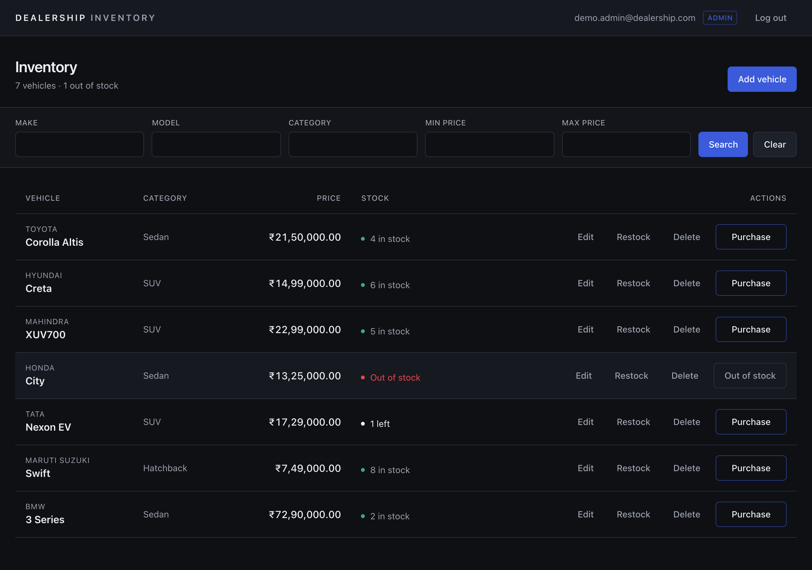
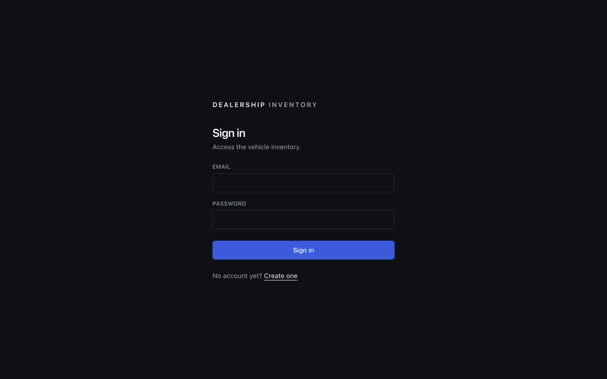
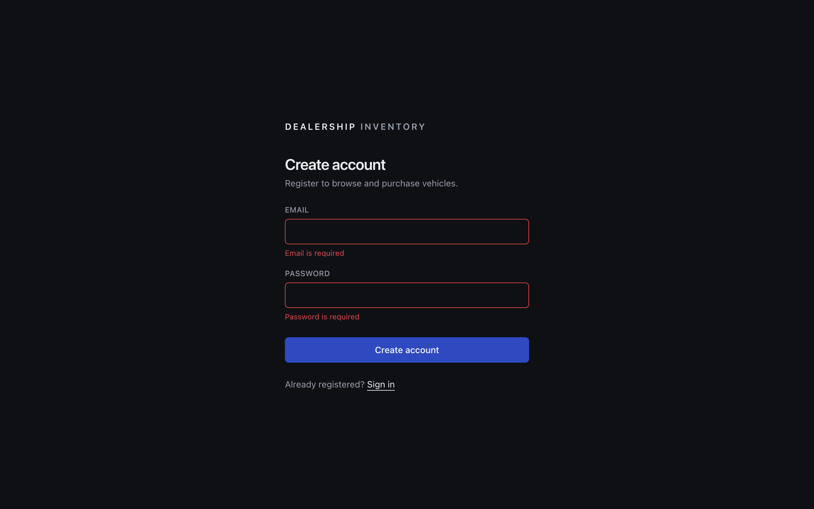
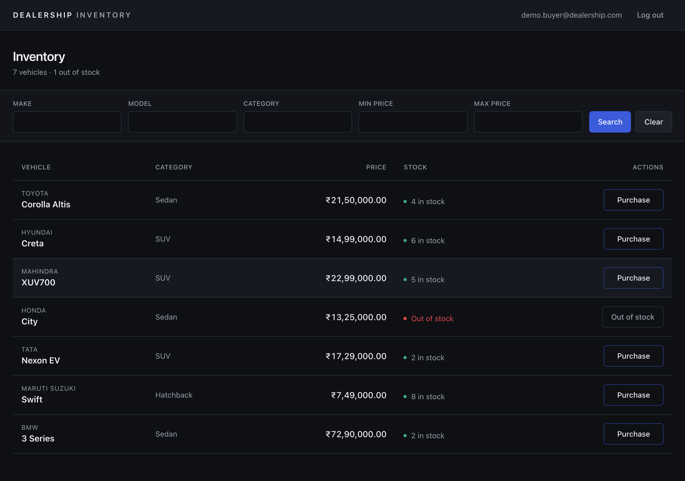
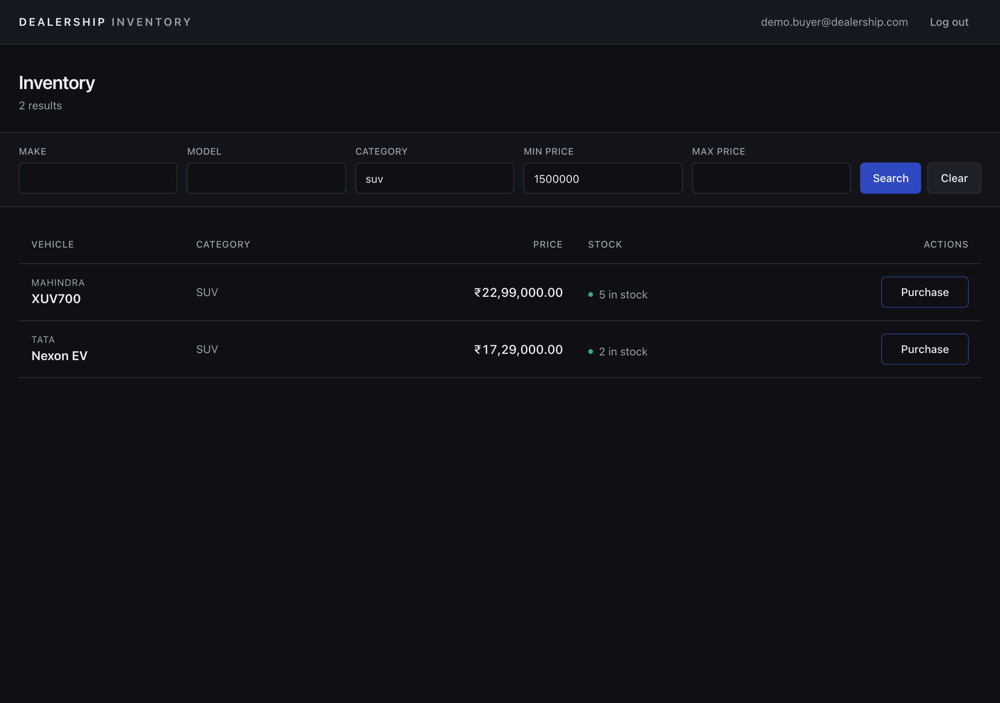
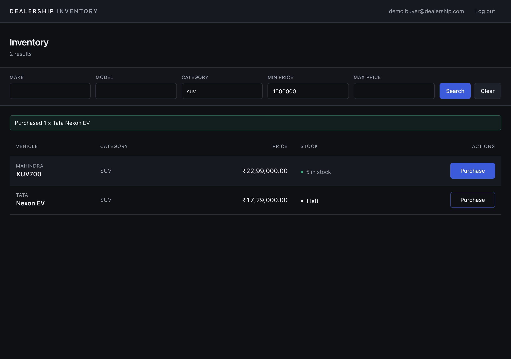
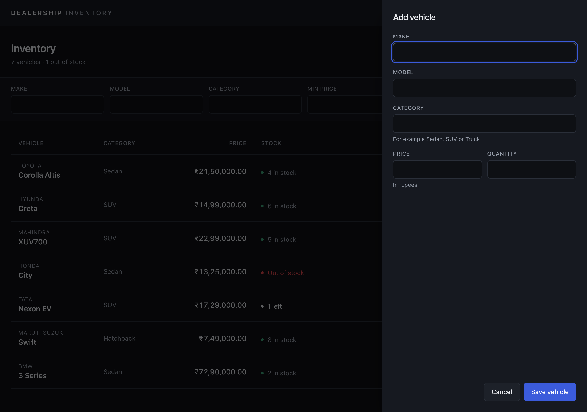
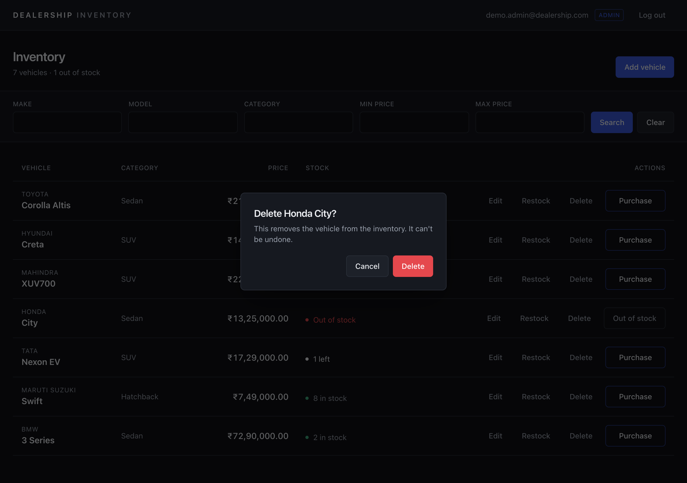
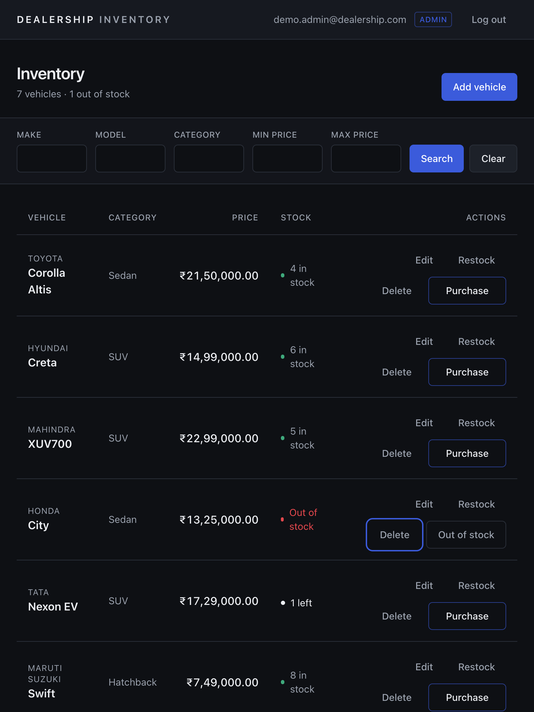
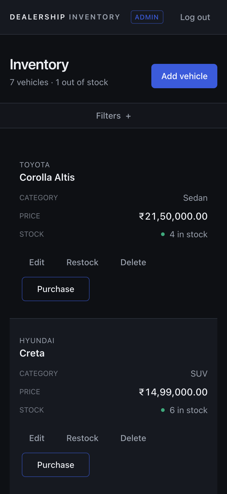

# Car Dealership Inventory System

A full-stack inventory system for a car dealership, built for the Incubyte Software Craftsperson TDD kata. Staff and customers sign in, browse and search the vehicle inventory, and purchase vehicles; administrators add, edit, restock and delete vehicles. Stock changes are safe under concurrent purchases, and all data is stored in PostgreSQL.



## Contents

- [Features](#features)
- [Tech stack](#tech-stack)
- [Architecture](#architecture)
- [Permissions](#permissions)
- [Getting started](#getting-started)
- [Running the tests](#running-the-tests)
- [API](#api)
- [Screenshots](#screenshots)
- [Test report](#test-report)
- [Development approach](#development-approach)
- [Known limitations](#known-limitations)
- [My AI Usage](#my-ai-usage)

## Features

- **Accounts:** registration and login with JWT bearer tokens. Passwords are stored as Argon2 hashes. Public registration always creates a regular user.
- **Inventory:** every vehicle with make, model, category, price (₹) and stock, including out-of-stock vehicles.
- **Search and filter:** by make or model (case-insensitive substring), category (case-insensitive exact match) and an inclusive price range. `%` and `_` are matched literally.
- **Purchasing:** one unit per purchase. The Purchase button is disabled at zero stock, and the backend refuses out-of-stock purchases with 409.
- **Concurrency safety:** a purchase is a single conditional `UPDATE … WHERE quantity > 0`, so simultaneous buyers can never oversell. A threaded test (CT-01) proves this against PostgreSQL.
- **Administration:** add and edit vehicles in a side panel, restock in a dialog, and delete after confirmation. Admin accounts are created only with a command-line script.
- **Responsive UI:** a table on tablet and desktop that becomes stacked rows on phones (375 px), with labelled inputs, visible focus and keyboard-accessible dialogs.

## Tech stack

| Layer | Technology |
|---|---|
| Backend | Python 3.14, FastAPI, SQLAlchemy 2, psycopg 3, Pydantic, PyJWT, pwdlib (Argon2) |
| Database | PostgreSQL 18 |
| Frontend | React 19, TypeScript, Vite, Tailwind CSS 4, React Router |
| Backend tests | pytest, FastAPI TestClient (HTTPX), pytest-cov, ruff |
| Frontend tests | Vitest, React Testing Library, user-event, jest-dom, v8 coverage, oxlint |

## Architecture

```
frontend/  React SPA ── fetch + Bearer token ──►  backend/  FastAPI
                                                   ├─ api/routes     HTTP only; map errors to status codes
                                                   ├─ api/deps       get_db, get_current_user, require_admin
                                                   ├─ schemas        request validation, response shapes
                                                   ├─ services       business rules (auth, vehicles, inventory)
                                                   ├─ models         SQLAlchemy tables and CHECK constraints
                                                   └─ scripts        init_db, create_admin
                                                          │
                                                          ▼
                                                     PostgreSQL
```

- **Routers** stay thin. **Services** hold the rules and raise domain errors (`VehicleNotFoundError`, `OutOfStockError`, `DuplicateEmailError`).
- The role is read from the database on every request, so demoting an admin takes effect immediately.
- **The database is the final safeguard:** `CHECK (quantity >= 0)`, `CHECK (price > 0)` and a unique email.

Planning documents are in [`docs/`](docs): [requirements and traceability](docs/REQUIREMENTS.md), the [test plan](docs/TEST_PLAN.md) and the [development plan](docs/DEVELOPMENT_PLAN.md).

## Permissions

| Endpoint | Signed out | Regular user | Admin |
|---|---|---|---|
| `POST /api/auth/register`, `POST /api/auth/login` | ✅ | ✅ | ✅ |
| `GET /api/vehicles`, `GET /api/vehicles/search` | 401 | ✅ | ✅ |
| `POST /api/vehicles/:id/purchase` | 401 | ✅ | ✅ |
| `POST /api/vehicles` (add), `PUT /api/vehicles/:id` (update) | 401 | 403 | ✅ |
| `DELETE /api/vehicles/:id`, `POST /api/vehicles/:id/restock` | 401 | 403 | ✅ |

**Our interpretation:**
- The assignment marks only delete and restock as admin-only.
- Its frontend section, however, gives the add, update and delete forms to admins only.
- We read that as the intended permission model, so **add and update are admin-only too** and are enforced on the server.

## Getting started

### Prerequisites

- **Python 3.12 or newer** (developed on 3.14)
- **Node.js 24 LTS** with npm
- **PostgreSQL** (developed on 18) and a superuser login to create the app's role and databases

### 1. Database

Connect as a PostgreSQL superuser, for example `psql -h localhost -U postgres -d postgres`, and create a least-privilege role and two databases:

```sql
CREATE ROLE car_dealership_app LOGIN NOSUPERUSER NOCREATEDB NOCREATEROLE NOINHERIT;
\password car_dealership_app
CREATE DATABASE car_dealership OWNER car_dealership_app;
CREATE DATABASE car_dealership_test OWNER car_dealership_app;
REVOKE CONNECT ON DATABASE car_dealership, car_dealership_test FROM PUBLIC;
```

The tests refuse to run unless the test database's name ends in `_test`, because they empty every table.

### 2. Backend

```bash
cd backend
```

```bash
python3 -m venv .venv
```

```bash
.venv/bin/pip install -r requirements-dev.txt
```

```bash
cp .env.example .env
```

Edit `backend/.env`. It's git-ignored; never commit it.
- In `DATABASE_URL` and `TEST_DATABASE_URL`, replace `CHANGE_ME` with the `car_dealership_app` password.
- Set `JWT_SECRET_KEY` to a long random value, for example from `python3 -c "import secrets; print(secrets.token_urlsafe(48))"`.

Then create the tables (safe to repeat) and an admin account. The script asks for the password twice without echoing it; there's deliberately no `--password` option. Running it for an existing regular user promotes that user without changing their password.

```bash
.venv/bin/python -m scripts.init_db
```

```bash
.venv/bin/python -m scripts.create_admin --email admin@example.com
```

Start the API on http://localhost:8000 (interactive docs at `/docs`):

```bash
.venv/bin/uvicorn app.main:create_app --factory --port 8000
```

### 3. Frontend

In a second terminal:

```bash
cd frontend
```

```bash
npm install
```

```bash
npm run dev
```

Open http://localhost:5173.
- The frontend calls `http://localhost:8000` by default; set `VITE_API_URL` in `frontend/.env` to change it.
- The backend allows browser requests only from origins listed in `CORS_ORIGINS`, which defaults to `["http://localhost:5173"]`.

## Running the tests

```bash
cd backend && .venv/bin/python -m pytest --cov=app --cov=scripts
```

```bash
cd frontend && npm test
```

Coverage for the frontend: `npm run coverage`. Lint: `.venv/bin/ruff check .` in `backend/`, and `npx oxlint` in `frontend/`.

## API

All `/api/vehicles` endpoints need `Authorization: Bearer <token>`. Errors use FastAPI's `{"detail": …}` format.

| Method and path | Body | Success | Errors |
|---|---|---|---|
| `POST /api/auth/register` | `{email, password}` (8–128 chars) | 201 `{id, email, role}` | 409 email taken, 422 |
| `POST /api/auth/login` | `{email, password}` | 200 `{access_token, token_type, user}` | 401, 422 |
| `GET /api/vehicles` | — | 200 list (all vehicles, oldest first) | 401 |
| `GET /api/vehicles/search` | query `make`, `model`, `category`, `min_price`, `max_price` | 200 list | 401, 422 (e.g. min > max) |
| `POST /api/vehicles` | `{make, model, category, price, quantity}` | 201 vehicle | 401, 403, 422 |
| `PUT /api/vehicles/:id` | all five fields (full replacement) | 200 vehicle | 401, 403, 404, 422 |
| `DELETE /api/vehicles/:id` | — | 204 | 401, 403, 404 |
| `POST /api/vehicles/:id/purchase` | — (one unit) | 200 vehicle | 401, 404, 409 out of stock |
| `POST /api/vehicles/:id/restock` | `{quantity}` (whole number ≥ 1, added to stock) | 200 vehicle | 401, 403, 404, 422 |

## Screenshots

All screenshots are of the running application with local demo data.

| | |
|---|---|
|  Sign in |  Registration validation |
|  Regular user's inventory |  Search by category and price |
|  Purchase confirmed |  Admin inventory |
|  Add vehicle panel |  Delete confirmation |
|  Tablet, 768 px |  Phone, 375 px |

## Test report

See **[docs/TEST_REPORT.md](docs/TEST_REPORT.md)**. It holds verbatim output from the final runs, the CT-01 concurrency results over repeated runs, the manual browser checklist, and the tests that weren't written.

| Suite | Result | Coverage |
|---|---|---|
| Backend (pytest against PostgreSQL) | 138 passed | 97% |
| Frontend (Vitest) | 29 passed | 88% of lines |

## Development approach

- **Test-driven development.** Each behaviour started with a failing test that was run and seen failing for the intended reason, then committed (`test: …`). Next came the smallest implementation that passed (`feat:` or `fix: …`), with refactors committed separately.
- **The commit messages record what was actually observed.** That includes cases where a test passed on its first run (committed as characterization tests) and a concurrency test whose first version failed only 11 of 20 runs before its harness was fixed.
- **Frontend tests** mock the API module and check what the user sees, using accessible roles and labels.
- **Commits** follow a `type: summary` convention, and every AI-assisted commit ends with a `Co-authored-by` trailer after two empty lines, as the assignment requires.

## Known limitations

- **No database migrations.** `init_db` creates missing tables but never alters existing ones; after a model change, the development tables have to be recreated.
- **Token storage.** The JWT is kept in `localStorage`, which is simple but readable by any script injected into the page. React's escaping is the mitigation. Tokens last 60 minutes and there are no refresh tokens.
- **Email case.** `A@x.com` and `a@x.com` count as different accounts; the case-insensitivity tests were left as lower priority.
- **Restock has no upper limit.** A restock large enough to exceed PostgreSQL's `INTEGER` range would fail with a server error.
- **No purchase history.** A purchase only decrements stock.
- **One lint warning.** The frontend's load-on-open effect triggers one oxlint warning (`set-state-in-effect`).
- **Not covered by automated tests:**
  - **Lower-priority tests from TEST_PLAN §9:** listed in the test report.
  - **Frontend-to-backend integration:** checked manually in the browser.
- **Co-author address in the early history.** The first 29 commits use the assignment's sample co-author address, `AI@users.noreply.github.com`. GitHub links that address to an unrelated user (`@ai`). Later commits use the vendors' official no-reply addresses (`noreply@anthropic.com` for Claude Code), and the pushed history wasn't rewritten. Details are in `docs/DEVELOPMENT_PLAN.md` §8.2.

## My AI Usage

### Tools used

- **Claude Code** (Anthropic, model Claude Opus 5.5), in the Claude desktop app. Used for planning, implementation, tests, debugging and documentation throughout the project.
- **ChatGPT** (OpenAI). Used to formulate and refine the prompts given to Claude Code and to discuss project planning.

### How they were used

- **Planning:** Claude Code read the assignment and drafted `docs/REQUIREMENTS.md`, `docs/TEST_PLAN.md` and `docs/DEVELOPMENT_PLAN.md`. I reviewed them and made the decisions recorded in their decisions register, such as admin-only add and update, the admin CLI and the API contract.
- **Test-driven implementation:** for every milestone, Claude Code wrote the failing tests, ran them and showed me the real failure, then wrote the smallest implementation and re-ran the suites. I approved each milestone's plan and each push.
- **Debugging and investigation:**
  - recovering access to my local PostgreSQL superuser account safely, with a backup and byte-for-byte rollback of `pg_hba.conf`, where I ran every privileged command myself;
  - finding that the assignment's sample co-author email credited an unrelated GitHub user;
  - making the concurrency test fail reliably.
- **Frontend and verification:** Claude Code built the React UI from a layout I approved. It tested the flows in a browser against the real backend, found and fixed a validation gap and a phone-layout problem, and took the screenshots.
- **Prompting:** I used ChatGPT to turn my goals into precise, staged instructions for Claude Code, with explicit stop points for approval.
- **Git:** every AI-assisted commit names Claude Code as co-author.

### Reflection

> _To be written in my own words before submission: how AI changed the workflow, what worked, what needed correcting, and what I would do differently._

The AI conversations behind this project are recorded in [`PROMPTS.md`](PROMPTS.md).
